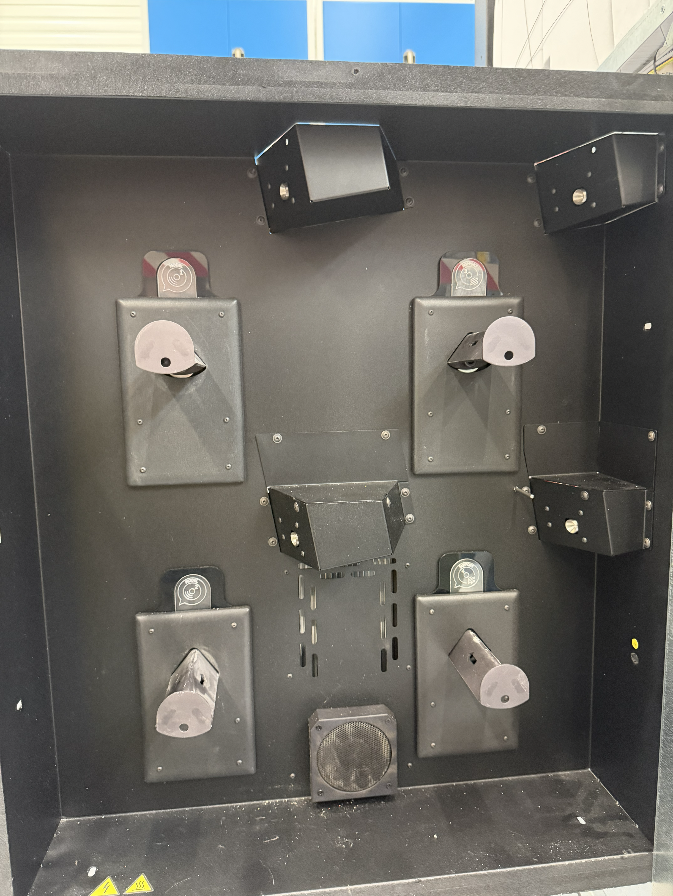

\newpage

::: {.callout-important}
## WICHTIG / TODO


- **Platine löten für Adapter**
- **I²C am Tool-Head ansteuern**
  - **Loadcells Code schreiben**
- Halter designen für neues Display als 3D-Druck
- Batteriesteuerung einbinden
- Vakuumpumpe richtig einbinden
- Filamentraum NFC einbinden


- KiCad:
  - X40 Einbringen
  - D-SUB9 Stecker Einbringen
  - X52 Einbringen

:::

::: {.callout-important}
## **Bestellen**
- Altes Display neu bestellen: Riverdi RVT101HVLNWC00-B
- 

:::


\newpage
# Doku F421
## Identifizierte Bauteile

|Name|Funktion|
|:-|-|
| Stepmotor X/Y| AM23HSA4B0-03|
| Stepmotor Z| AM24HS5401-10N|
| Step Motor Extruder | 17HS16-2004S1|
| Batterie| RoHS Compliment: MPF0005900GP|
| Batterie Steuerung| FSP Power Station: Knight RM 6KL / PPF48A0400|
| Kamera | OV2640 |
|Endschalter|TCST2103|
|Innenraum Lampen|Osram i278 Halogen|
|NFC Reader|F380.13.024|
|Touchscreen| Riverdi: RVT101HVLNWC00-B, Maße Aussparung: 230x152|

: Bauteile am F421 {#tbl-parts}

\newpage
## Pin-Tabelle

|Funktion|Pin|Leitungsbeschriftung|Ort|Anschluss|
|:-|-|-|-|-|
|48V Eingang|X1||Hardware Platine|Stecker|
|24V Eingang|X3||Hardware Platine|Stecker|
|Status LED|X44|NC/X44|Hardware Platine|Stecker|
|Deckel Kontakt |X39 |NC/X39|Hardware Platine|Stecker|
|Power ON Panel Anschluss direkt an Raspberry Pi J2|X43 |NC/X43 |Hardware Platine|Stecker|
| Tür| X37 (Kontakt)/ X38 (Öffner)| DLCK / NC/X37;38| Hardware Platine|Stecker|
| | Q1 / Q2 --> X16| OZA / NC/X16| Hardware Platine|Stecker|
| Endschalter X| X12| NC/X12| Hardware Platine| Stecker|
| Endschalter Y| X13| NC/X13| Hardware Platine| Stecker|
| Endschalter Z| X15| NC/X15| Hardware Platine| Stecker|
| StepMotorX| X5| NC/X5| Hardware Platine/ Linker Driver| Stecker|
| StepMotorY| X6| NC/X6| Hardware Platine/ Mittlerer Driver| Stecker|
| StepMotorZ| X7| NC/X7| Hardware Platine/ Rechter Driver| Stecker|
| ExtruderStepR| X10| NC/X10| Hardware Platine| Stecker|
| ExtruderStepL| X9| NC/X9| Hardware Platine| Stecker|
| Steuerung Headend| X48| NC/X48| Hardware Platine| Stecker|
| I²C BUS Extruder| X28.1| NC/X28.1| Hardware Platine| Stecker|
| Steuerung 230V PLatine (siehe @tbl-dsub26)| X46| NC/X46| Hardware Platine| Stecker|
| Steuerung Filament| X29.1| NC/X29.1| Hardware Platine| Stecker|
| Magnetschiene Y| X31| NC/X31| Hardware Platine| Stecker|
| Magnetschiene X| X30| NC/X30| Hardware Platine| Stecker|
| Vakuum Pumpe|J2| Relais?| Hardware Platine| Stecker|
| Chamber Fan| J4| Extruder| Hardware Platine| Stecker|
| Blower Power| J3|Raum| Hardware Platine| Stecker|
|Bauraum Temp Fühler (PT1000)| X22| NC/X22| Hardware Platine| Stecker|
|**???**| X40| NC/X40| Hardware Platine| Stecker|
|Heizbett Temp Fühler Heizelemnt NTC|X20| NC/X20| Hardware Platine| Stecker|
|Bauraum hinten links Temp Fühler NTC|X23| NC/X23|Hardware Platine|Stecker|
|Heizbett Temp Fühler Heizbett NTC|X56| NC/X56|Hardware Platine|Stecker|
|Not-Aus Feedback|X16| NC/X16|Hardware Platine|Stecker|
|Extruder Steuerung **???**|X52| NC/X52|Hardware Platine|Stecker|
|Gehäuselüfter|X25.1| NC/X25.1|Hardware Platine|Stecker|
|Batterie Steuerung|X36B| NC/X36B|Hardware Platine|Stecker|
|Batterie Steuerung|X36A| NC/X36A|Hardware Platine|Stecker|
|Steuerung Absaugung|X45| NC/X45|Hardware Platine|Stecker|
|-|-|-|-|-|
|Kamera|Camera Adapter|HMI/X7|Software Platine|Stecker|
|-|-|-|-|-|
|Innenraum LED vorne|CHLight | |Power Platine|Stecker|
|Vakuum Pumpe Stannung|FAN | HVO/J4|Power Platine|Stecker|
|-|-|-|-|-|
| Not AUS| SK1| |Schütz unter Mainboard|WS: GB: BR: GN:|

: Pin Anschlüsse an den Mainboards {#tbl-PINS}

\newpage
### D-SUB26 an X46

|Funktion|SUB26|PIN20 X48|KiCAD|PIN2 X52|PIN4 X28_1|PIN8 (Extruder)|
|-|-|-|-|-|-|-|
|Tool0 (6,7,8) VIN|1|11|1||||
|Tool0 (5) PT1000|2|13|3||||
|Tool0 (1) PT1000|3|14|4||||
|Tool1 (1) PT1000|-"-|-"-|-"-||||
|Tool0 (2,3,4)|4|15|5||||
|Tool1 (2,3,4)|-"-|-"-||||
||5||1 (Braun)||||
|Tool1 (6,7,8) VIN|6|17|7||||
|Tool1 (5) PT1000|7|19|9||||
|Tool0 (1) PT1000|8|20|10||||
|Tool1 (1) PT1000|-"-|-"-|-"-||||
|Tool0 (2,3,4)|9|1|11|||||
|Tool1 (2,3,4)|-"-|-"-||||
|Tool0 (6,7,8) VIN|10|12|2||||
|VCC 3.3V I²C Heatend|11|3|13||||
|Fan-T0-HV (RT)|12|4|14||||
|Tool0 (2,3,4)|13|16|6||||
|Tool1 (2,3,4)|-"-|-"-||||
||14||2 (Weiß)||||
|Tool1 (6,7,8) VIN|15|18|8||||
|VCC 3.3V I²C Heatend|16|5|15||||
|Fan-T1-HV (SW)|17|6|16||||
|Tool0 (2,3,4)|18|2|12||||
|Tool1 (2,3,4)|-"-|-"-||||
|Servo (Schwarz)|19|7|17||||
|Tool0 (2,3,4)|20|8|18||||
|Tool1 (2,3,4)|-"-|-"-||||
|Servo (Rot)|21|9|19||||
|Fan-T0-HV (SW)|-"-|-"-||||
|Fan-T1-HV (RT)|-"-|-"-||||
|Servo (Gelb)|22|10|20||||
|SCL Heatend|23||||?|6 (Braun)|
|SDA Heatend|24||||?|3 (Grün)|
|SCL Heatend|25||||?|7 (Gelb)|
|SDA Heatend|26||||?|2 (Weiß)|

: Pinbelegung X46 am D-SUB26 Stecker {#tbl-dsub26}

\newpage
### Load-Cell Ansteuerung 

**TENSO0:**

|Ader|Funktion|PIN|
|-|-|-|
|Rot||| 
|Schwarz|GND|18|
|Weiß|||
|Grün|||


**TENSO1:**

|Ader|Funktion|PIN|
|-|-|-|
|Rot||| 
|Schwarz|GND|18|
|Weiß|||
|Grün|||

\newpage
### Brücke 230V Platine für Heizbett usw.

|Pin|Voltage in U|Funktion|
|-|-|-|
|1 |5|Lüfter Platine|
|2 |3.3|LEDs Innenraum|
|3 |3.3|Lüfter/Bauraum Hinten|
|4 ||???|
|5 |GND|Potential|
|6 ||???|
|7 |3.3|Luftfilter unter Mainboard|
|8 ||???|
|9 ||???|
|10|3.3|Heizbett|

: Brücken Pins zur Relais-Platine {#tbl-230}


### Optische Sensoren Pinbelegung

|Ader|Funktion|Anschluss|
|-|-|-|
|Gelb |+|5 V dazwischen 220$\Omega$|
|Grün |Emitter|GND|
|Weiß |+|Signal mit Pull-Up im Code|
|Braun |Drain/ Kollektor|GND|

: Optischer Sensor {#tbl-opticalpin}

### Motoren Pinbelegung

|Ader Motor|Ader Board|Funktion|
|-|-|-|
|Schwarz|Braun|A/A+/A1|
|Grün|Grün |C/A-/A2|
|Rot|Gelb |B/B+/B1|
|Blau|Weiß |D/B-/B2|

: Motor Pinbelegung {#tbl-motorpin}

\newpage
## I²C
### I²C Heatend

- 0x49 Loadcell 0
- 0x4a Loadcell 1
- 0x54 **???**

#### Bauteile 

- Texas Instuments: 1C I333
- ATMLH732
- MCP**96L01**

### I²C Bus Filament Steuerung

{#fig-i2c_filament width=50%}

- 0x6a: Hauptplatine
- 0x6c: Support 4
- 0x6d: Model 2
- 0x6e: Support 3
- 0x6f: Model 1 => 53s bei 0x64 bis Headend

- Braun: VCC
- Weiß: GND
- Grün: SDA
- Gelb: SCL
  
\newpage

### Hauptplatine

|Register|Beschreibbar|Funktion|Änderungen|
|:-|-|-|-|
|0x00|Nein|**???**|**???**|
|0x01|Nein|**???**|**???**|
|0x02|Nein|**???**|**???**|
|0x03|Nein|**???**|**???**|
|0x04|Nein|Temperaturfühler Filament Innenraum|Temperatur in Hex|
|0x05|Ja|Lüfter- und Heizungs-Steuerung Innenraum Filament|PWM: 0x00-0xff|
|0x06|Ja|**???**|**???**|
|0x07|Nein|**???**|**???**|
|0x08|Ja|**???**|**???**|
|0x09|Ja|**???**|**???**|
|0x0a|Nein|**???**|**???**|
|0x0b|Nein|**???**|**???**|
|0x0c|Nein|**???**|**???**|
|0x0d|Nein|**???**|**???**|
|0x0e|Nein|Temperaturfühler Lüfter/Heizung|Temperatur in Hex|
|0x0f|Ja|**???**|**???**|
|0x10|Nein|**???**|**???**|

### Filament Platinen

|Register|Beschreibbar|Funktion|Änderungen|
|:-|-|-|-|
|0x00|Nein|**???**|Default: de|
|0x01|Nein|**???**|Default: 11|
|0x02|Nein|**???**|Default: 19|
|0x03|Nein|Filamenterkennung|0x01: leer, 0x03: Filament erkannt|
|0x04|Nein|**???**|**???**|
|0x05|Ja|Geschwindigkeit Motor Vorwärts|Default:0x64|
|0x06|Ja|Geschwindigkeit Motor Rückwärts|Default:0x64|
|0x07|Ja|**???**|Default: 0x28|
|0x08|Ja|**???**|Default: 0x06|
|0x09|Ja|**???**|Default: 0x1e|
|0x0a|Ja|Motorsteuerung|Default: 0x00, 0x01: Durchgehendes fahren vor,0x02: Durchgehendes fahren zurück, 0x03: Ein Step|
|0x0b|Ja|NFC Aktualisierer|Default: 0x00, Wenn auf 0x01 gesetzt wird wird NFC aktualisiert|
|0x0c|Nein|**???**|Default: 0x00|
|0x0d|Nein|**???**|Default: 0x00|
|0x0e-0x14|Nein|NFC Erkennung|Default: 0x00|
|0x60|Ja|LED Rot|Default: 0x00|
|0x61|Ja|LED Grün|Default: 0x00|
|0x62|Ja|LED Blau|Default: 0x00|
|0x63|Ja|LED Blickgeschwindigkeit|Default: 0x00|

#### NFC Filament Codes

**3Dgence Weiß 1.75mm 230-245°**

|Register|Wert|
|:-|-|
|0x0e|0x04|
|0x0f|0xf2|
|0x10|0xad|
|0x11|0x03|
|0x12|0xb3|
|0x13|0x57|
|0x14|0xcf|
|0x15|0x00|
|0x16|0x08|

**3Dgence ABS Schwarz 1.75mm 250-270°**

|Register|Wert|
|:-|-|
|0x0e|0x04|
|0x0f|0x32|
|0x10|0xcf|
|0x11|0xc6|
|0x12|0x4d|
|0x13|0x57|
|0x14|0xcf|
|0x15|0x00|
|0x16|0x08|

## I2C Splitter Pins

Alle sind gleich aufgebaut es gibt nur Brücken die durchverbinden.

1-1 = oben 
1-2 = unten

|Pin|Funktion|
|-|-|
|1-1| SDA|
|1-2| SCL|
|2-1|SDA Buffered|
|2-2|SCL Buffered|
|3-1|**???**|
|3-2|**???**|
|4-1|VCC|
|4-2|GND|

### Anschluss Flow

grün -> gelb
gelb -> weiß
weiß -> schwarz
braun -> rot

\newpage
\clearpage
\pagewidth=420mm
\pageheight=297mm
\newgeometry{textwidth=370mm, textheight=237mm, top=30mm, left=25mm}
| Pin | 1-1 | 1-2 | 1-3 | 1-4 | 1-5 | 1-6 | 1-7 | 1-8 | 2-1 | 2-2 | 2-3 | 2-4 | 2-5 | 2-6 | 2-7 | 2-8 | 3-1 | 3-2 | 3-3 | 3-4 | 3-5 | 3-6 | 3-7 | 3-8 | 4-1 | 4-2 | 4-3 | 4-4 | 4-5 | 4-6 | 4-7 | 4-8 |
|---|---|---|---|---|---|---|---|---|---|---|---|---|---|---|---|---|---|---|---|---|---|---|---|---|---|---|---|---|---|---|---|---|
| **1-1** | — | | | | | | | | | | | | | | | | | | | | | | | | | | | | | | | |
| **1-2** | | — | | | | | | | | | | | | | | | | | | | | | | | | | | | | | | |
| **1-3** | | | — | | | | | | | | | | | | | | | | | | | | | | | | | | | | | |
| **1-4** | | | | — | | | | | | | | | | | | | | | | | | | | | | | | | | | | |
| **1-5** | | | | | — | | | | | | | | | | | | | | | | | | | | | | | | | | | |
| **1-6** | | | | | | — | | | | | | | | | | | | | | | | | | | | | | | | | | |
| **1-7** | | | | | | | — | | | | | | | | | | | | | | | | | | | | | | | | | |
| **1-8** | | | | | | | | — | | | | | | | | | | | | | | | | | | | | | | | | |
| **2-1** | | | | | | | | | — | | | | | | | | | | | | | | | | | | | | | | | |
| **2-2** | | | | | | | | | | — | | | | | | | | | | | | | | | | | | | | | | |
| **2-3** | | | | | | | | | | | — | | | | | | | | | | | | | | | | | | | | | |
| **2-4** | | | | | | | | | | | | — | | | | | | | | | | | | | | | | | | | | |
| **2-5** | | | | | | | | | | | | | — | | | | | | | | | | | | | | | | | | | |
| **2-6** | | | | | | | | | | | | | | — | | | | | | | | | | | | | | | | | | |
| **2-7** | | | | | | | | | | | | | | | — | | | | | | | | | | | | | | | | | |
| **2-8** | | | | | | | | | | | | | | | | — | | | | | | | | | | | | | | | | |
| **3-1** | | | | | | | | | | | | | | | | | — | | | | | | | | | | | | | | | |
| **3-2** | | | | | | | | | | | | | | | | | | — | | | | | | | | | | | | | | |
| **3-3** | | | | | | | | | | | | | | | | | | | — | | | | | | | | | | | | | |
| **3-4** | | | | | | | | | | | | | | | | | | | | — | | | | | | | | | | | | |
| **3-5** | | | | | | | | | | | | | | | | | | | | | — | | | | | | | | | | | |
| **3-6** | | | | | | | | | | | | | | | | | | | | | | — | | | | | | | | | | |
| **3-7** | | | | | | | | | | | | | | | | | | | | | | | — | | | | | | | | | |
| **3-8** | | | | | | | | | | | | | | | | | | | | | | | | — | | | | | | | | |
| **4-1** | | | | | | | | | | | | | | | | | | | | | | | | | — | | | | | | | |
| **4-2** | | | | | | | | | | | | | | | | | | | | | | | | | | — | | | | | | |
| **4-3** | | | | | | | | | | | | | | | | | | | | | | | | | | | — | | | | | |
| **4-4** | | | | | | | | | | | | | | | | | | | | | | | | | | | | — | | | | |
| **4-5** | | | | | | | | | | | | | | | | | | | | | | | | | | | | | — | | | |
| **4-6** | | | | | | | | | | | | | | | | | | | | | | | | | | | | | | — | | |
| **4-7** | | | | | | | | | | | | | | | | | | | | | | | | | | | | | | | — | |
| **4-8** | | | | | | | | | | | | | | | | | | | | | | | | | | | | | | | | — |

: I2C Splitter Pins

\clearpage
\restoregeometry
\pagewidth=210mm
\pageheight=297mm

```{=latex}
\begin{figure}[H]
\centering
  \begin{tikzpicture}[scale=0.8, every node/.style={transform shape}]

    % Makro für kompakten 8-Pin Stecker
    % #1: X-Offset, #2: Y-Offset, #3: Rotation, #4: Stecker-Nummer (1, 2, 3, 4)
    \newcommand{\drawcompactconnector}[4]{
      \begin{scope}[shift={(#1,#2)}, rotate=#3]
        % Gehäuse
        \draw[fill=gray!15, draw=black!80, thick, rounded corners=4pt] (-1.3, -3.2) rectangle (1.3, 3.2);
        % Rastnase
        \draw[fill=gray!30, draw=black!80, thick, rounded corners=1pt] (1.3, -0.9) -- (1.6, -0.9) -- (1.6, 0.9) -- (1.3, 0.9) -- cycle;

        % Linke Spalte (Pins 1 bis 4 des jeweiligen Steckers)
        \foreach \y/\pinnum in {2.25/5, 0.75/6, -0.75/7, -2.25/8} {
            \draw[fill=white, draw=gray!70] (-0.9, \y-0.35) rectangle (-0.1, \y+0.35);
            \draw[fill=yellow!70!orange, draw=orange!90!black, thick] (-0.5, \y) circle (0.16);
            % Text-Node wird um -#3 gegengedreht, damit der Text aufrecht bleibt
            \node[rotate=-#3, text=black, font=\sffamily\bfseries\tiny] at (-0.5, \y) {#4-\pinnum};
        }

        % Rechte Spalte (Pins 5 bis 8 des jeweiligen Steckers)
        \foreach \y/\pinnum in {2.25/1, 0.75/2, -0.75/3, -2.25/4} {
            \draw[fill=white, draw=gray!70] (0.1, \y-0.35) rectangle (0.9, \y+0.35);
            \draw[fill=yellow!70!orange, draw=orange!90!black, thick] (0.5, \y) circle (0.16);
            % Text-Node wird um -#3 gegengedreht, damit der Text aufrecht bleibt
            \node[rotate=-#3, text=black, font=\sffamily\bfseries\tiny] at (0.5, \y) {#4-\pinnum};
        }
      \end{scope}
    }

    % Stecker 1 (Links oben) -> Pins 1-1 bis 1-8
    \drawcompactconnector{0}{7.5}{0}{1}

    % Stecker 2 (Links mitte) -> Pins 2-1 bis 2-8
    \drawcompactconnector{0}{0}{0}{2}

    % Stecker 3 (Links unten) -> Pins 3-1 bis 3-8
    \drawcompactconnector{0}{-7.5}{0}{3}

    % Stecker 4 (Rechts unten, 180 Grad gedreht) -> Pins 4-1 bis 4-8 (Schrift bleibt richtig herum)
    \drawcompactconnector{5.5}{-7.5}{180}{4}

  \end{tikzpicture}
\end{figure}
```
\newpage
# Kraken Doku
## Pin Belegung

|Name|Spannung|MCU|Steuer-Pin|
|-|-|-|-|
|Motor X|24-60 V|1| Dir: PC13, Step: PC14, EN: PE6, CS: PD6|
|Motor Y|24-60 V|1| Dir: PE4, Step: PE5, EN: PE3, CS: PD5|
|Motor Z|24-60 V|1| Dir: PE1, Step: PE2, EN: PE0, CS: PD4|
|Motor Extruder Links|24-60 V|1| Dir: PG10, Step: PB9, EN: PG13, CS: PD2|
|Motor Extruder Rechts|24-60 V|1| Dir: PD7, Step: PG11, EN: PG12, CS: PA15|
|Endschalter X|5 V|1| PC15|
|Endschalter Y|5 V|1| PF0|
|Endschalter Z|5 V|1| PF1|
|Magnetschiene X|5 V|Eventuell RP2040|**???**|
|Magnetschiene Y|5 V|Eventuell RP2040|**???**|
|Magnetschiene Z|5 V|Eventuell RP2040|**???**|
|Türkontakt|5 V|2| PF10|
|Deckelkontakt|5 V|2| PC0|
|Servo Hotend|5 V|1| PE7|
|Motor Power|42 V|1,2| Motor Power|
|Board Power|24 V|1,2| Board Power|
|PT1000 Hotend Links|5 V|1| PC9, 31865-1|
|PT1000 Hotend Rechts|5 V|1| PA8, 31865-2|
|Hotend Heater Links|12-24 V|1| PF6|
|Hotend Heater Rechts|12-24 V|1| PF7|
|Gehäuselüfter|24 V|1| PA0|
|Hotendlüfter Links|5-24? V|1| PA1|
|Hotendlüfter Rechts|5-24? V|1| PA2|
|Status LED Rot|24 V|2| PA0|
|Status LED Gelb|24 V|2| PA1|
|Status LED Grün|24 V|2| PA2|
|Status Buzzer|24 V|2| PA3|
|Türöffner|24 V|2| PA4|
|230V Platine|5 V|1| 5V EXP1|
|Absaugung Hotend|3.3 V|1| PG3|
|Lüfter Hinten|3.3 V|1| PD13|
|Heizbett|3.3 V|1| PD15|
|Bauraum LED|3.3 V|1| PG5|
|Loadcell Extruder Links|5 V|1| **???** Wenn altes nicht funktioniert ADS1220 und SPI4 Bus und unterschiedliche CS und Ready pins oder 2 Loadcells an einer ADS1220|
|Loadcell Extruder Rechts|5 V|1| **???** Wenn altes nicht funktioniert ADS1220 und SPI4 Bus und unterschiedliche CS und Ready pins oder 2 Loadcells an einer ADS1220|
|Filament Steuerung|**???**|1| **Protokoll noch unklar**|
|Bauraum Temperatur|**???**|1| **Sensor unklar**|
|Raspberry Pi|5 V|1| PD8, PD9 / USB|
|Kamera|5 V|1| USB an Raspberry Pi|
|Display|5 V|1| USB an Raspberry Pi|


## Ansteuerung Magnetschienen

- 5V VCC an RP2040 und Magnetschienen VCC
- GND an RP2040 und Magnetschienen GND
- Signal von Magnetschiene an 10kOhm -> Abgriff mit RP2040 GPIO -> 20kOhm auf GND
- Je 2 Signalleitungen pro Magnetschiene
  - Insgesamt 6 Signalleitungen für X/Y/Z Magnetschienen

## Anschluss RP2040 & Kraken

- Uart0:
  - Kraken PD8 (TX3) $\rightarrow$ Pi GPIO 15 (RX / Header Pin 10)
  - Kraken PD9 (RX3) $\rightarrow$ Pi GPIO 14 (TX / Header Pin 8)
- Uart2:
  - RP2040 GP0 (TX) $\rightarrow$ Pi GPIO 5 (RX2 / Header Pin 29)
  - RP2040 GP1 (RX) $\rightarrow$ Pi GPIO 4 (TX2 / Header Pin 7)


# Display Maße

|Name|Maß in mm|
|-|-|
|Breite|143|
|Tiefen|7|
|Höhe|234|
|Platinen abstand von längerer Seite|9.2|
|Platinen abstand von kürzerer Seite|0|
|Platinen Höhe|140|
|Platinen Breite|56|
|Platinen Tiefe|1.6|
|Gesamthöhe mit Platine|12|